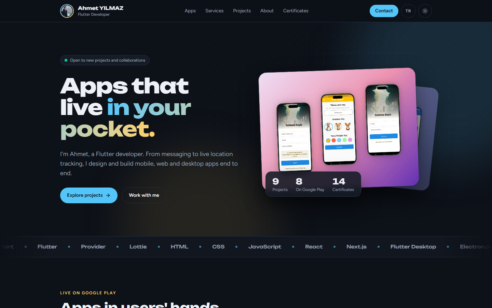

<div align="center">

# Ahmet YILMAZ

**Flutter Developer · Mobile, Web & Desktop · AI Automation**

I design and build apps that live in your pocket, from messaging to live location tracking,
and I automate repetitive work with locally hosted AI.

[](https://ahmetyilmazz.github.io)
[](https://www.linkedin.com/in/ahmeeet/)
[](https://play.google.com/store/apps/developer?id=Ahmet+YIILMAZ)

<a href="https://ahmetyilmazz.github.io"></a>

</div>

## About me

I graduated in Mathematics and Computer Science. Years of differential equations and abstract algebra taught me to break problems down and model them, and I bring the same approach to software.

I build apps with Flutter that reach mobile, web and desktop from a single codebase, and I care about clean architecture, readable code and interfaces people enjoy using. Lately I have also been building content and workflow automations with locally hosted large language models (Ollama) and n8n.

**Open to new projects and collaborations.**

## Live on Google Play

| Apps I published | Apps I developed for ORELTEK |
|---|---|
| [Kelengo: English Vocabulary](https://play.google.com/store/apps/details?id=app.ahmetylmzzz.words) | [MyRoutines: Kids Reward Chart](https://play.google.com/store/apps/details?id=com.oreltek.gorevlerim) |
| [Learn Words in 11 Languages](https://play.google.com/store/apps/details?id=com.ahmetylmzzz.learnWord) | [ORELTEK Tamga](https://play.google.com/store/apps/details?id=com.oreltek.tamga) |
| [Basic Math: Fun Adventure](https://play.google.com/store/apps/details?id=app.ahmetylmzzz.matematik) | [Peg Solitaire: Brain Puzzle](https://play.google.com/store/apps/details?id=com.oreltek_solo_test) |
| [Solo Test](https://play.google.com/store/apps/details?id=app.ahmetylmzzz.solo_test) | [Cöcük Böcük: Cockroach Smash](https://play.google.com/store/apps/details?id=com.oreltek.bocekoyunu) |

## Selected projects

Each project has its own page on the site with the problem, the solution and the technologies used.

| Project | What it is |
|---|---|
| [Muhabbet](https://ahmetyilmazz.github.io/en/projects/muhabbet/) | A safe messaging app with voice and video calls, designed for young users. |
| [Highway Guide](https://ahmetyilmazz.github.io/en/projects/otoyol-rehberim/) | A driving assistant that calculates a safe speed live, based on minimum travel times between toll gates. |
| [MyRoutines](https://ahmetyilmazz.github.io/en/projects/gorevlerim/) | A gamified chore chart that builds routines for kids with stars and rewards. *Developed for ORELTEK.* |
| [Kelengo](https://ahmetyilmazz.github.io/en/projects/learn-english/) | An offline vocabulary app that teaches 6,000 English words level by level, from A1 to C2. |
| [LinkedIn Content Automation](https://ahmetyilmazz.github.io/en/projects/linkedin-content-automation/) | Follows Flutter news, writes LinkedIn posts with a locally running Gemma 4 model and publishes them on schedule. |
| [YouTube Shorts Automation](https://ahmetyilmazz.github.io/en/projects/youtube-shorts-automation/) | Produces and publishes YouTube Shorts, with scripts written by a locally running Gemma 4 model. |

More projects and certificates are on the [website](https://ahmetyilmazz.github.io).

## What I work with

| | |
|---|---|
| **Mobile** | Dart, Flutter, Provider, Lottie |
| **Web** | HTML, CSS, JavaScript, React, Next.js |
| **Desktop** | Flutter Desktop, Electron.js |
| **Data & services** | Firebase, SQLite, REST API, JSON, Google AdMob |
| **AI & automation** | Ollama, Gemma 4, n8n, Docker |

## Services

- **Mobile apps:** fast Android and iOS apps from a single Flutter codebase.
- **Web apps:** fast, SEO-friendly and responsive websites with React and Next.js.
- **Desktop software:** apps for Windows, macOS and Linux with Flutter Desktop and Electron.js.
- **AI & automation:** workflow automation with n8n, locally hosted language models and AI features inside your apps.

## Contact

For freelance work, collaborations or to request my CV:

- **Email:** ahmeet.ylmzzz@gmail.com
- **LinkedIn:** [linkedin.com/in/ahmeeet](https://www.linkedin.com/in/ahmeeet/)
- **Website:** [ahmetyilmazz.github.io](https://ahmetyilmazz.github.io)

<details>
<summary><strong>Türkçe</strong></summary>

<br>

Merhaba, ben **Ahmet YILMAZ**. Matematik-Bilgisayar bölümünden mezun oldum ve Flutter ile mobil, web ve masaüstü uygulamalar geliştiriyorum. Son dönemde yerelde çalışan büyük dil modelleri (Ollama) ve n8n ile içerik ve iş akışı otomasyonları da kuruyorum.

Google Play'de kendi yayınladığım uygulamalar ve ORELTEK için geliştirdiğim uygulamalar, proje sayfaları, hizmetlerim ve sertifikalarım sitemde Türkçe ve İngilizce olarak yer alıyor: **https://ahmetyilmazz.github.io/tr/**

Freelance proje, iş birliği veya CV talebi için bana e-posta (ahmeet.ylmzzz@gmail.com) ya da [LinkedIn](https://www.linkedin.com/in/ahmeeet/) üzerinden ulaşabilirsiniz.

</details>

<details>
<summary><strong>About this repository</strong></summary>

<br>

This repository hosts the source of [ahmetyilmazz.github.io](https://ahmetyilmazz.github.io). It is built with Next.js 16, React 19, TypeScript and Tailwind CSS 4 as a fully static, bilingual (TR / EN) site, and every push to `main` is deployed to GitHub Pages by [GitHub Actions](.github/workflows/nextjs.yml).

```bash
npm ci          # install dependencies (Node.js 20.9+)
npm run dev     # http://localhost:3000/tr/
npm run build   # static export to ./out
```

Content lives in `src/content/` and `src/i18n/dictionaries/`. The change history is kept in Turkish in [DEGISIKLIKLER.md](DEGISIKLIKLER.md).

</details>

---

<sub>© Ahmet YILMAZ. All rights reserved.</sub>
